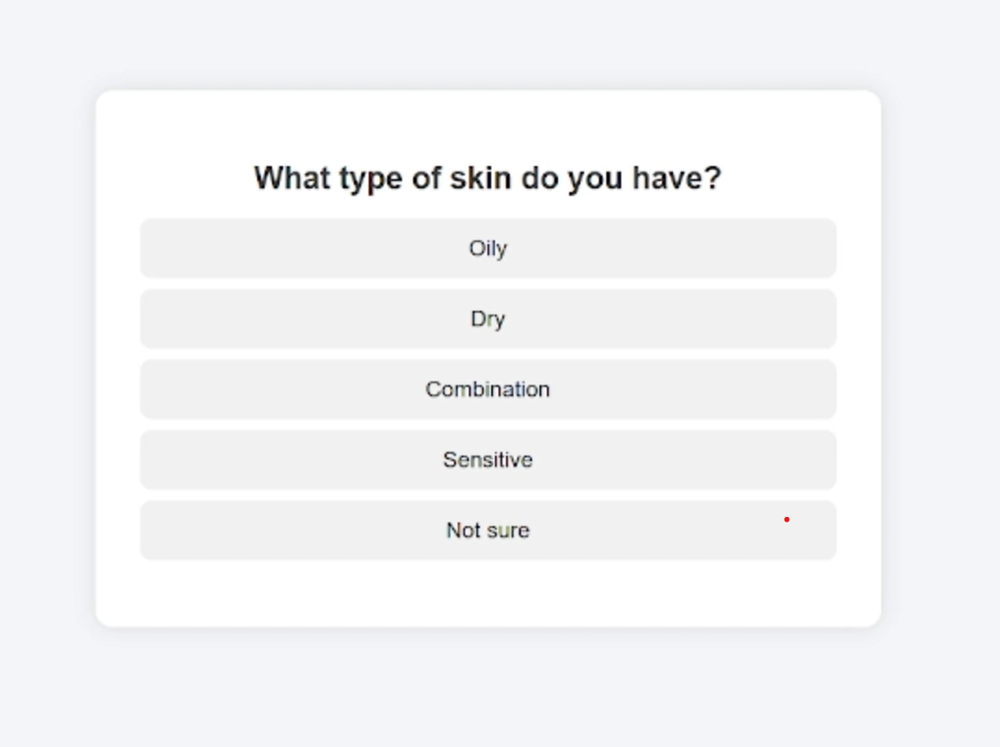
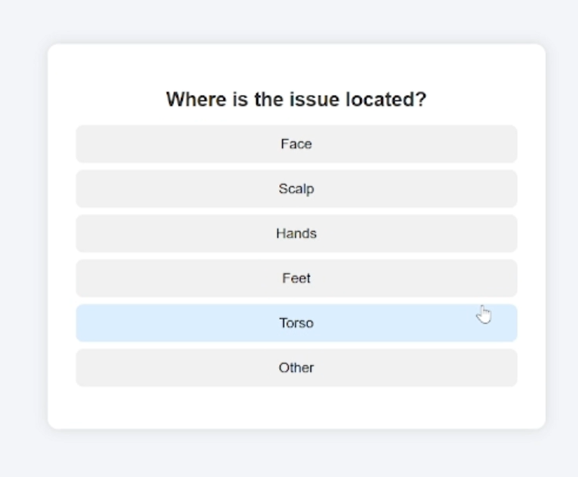
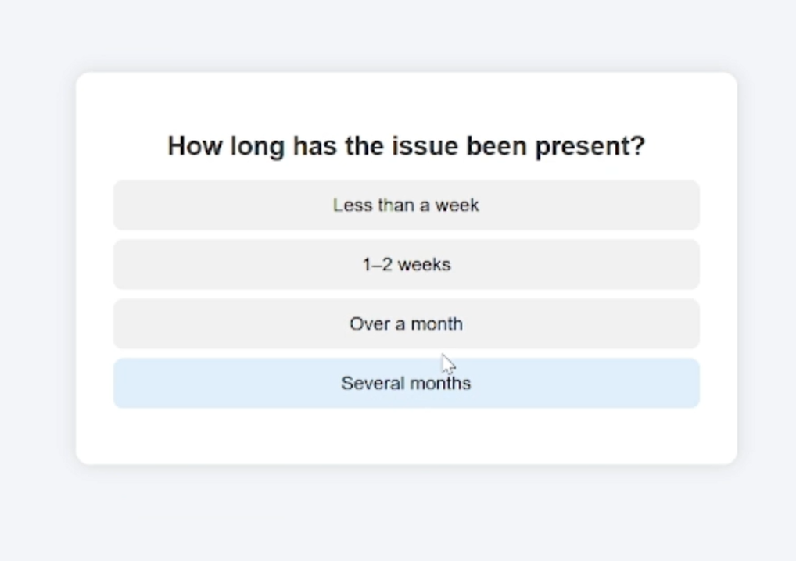
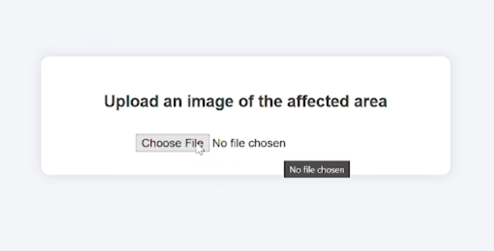
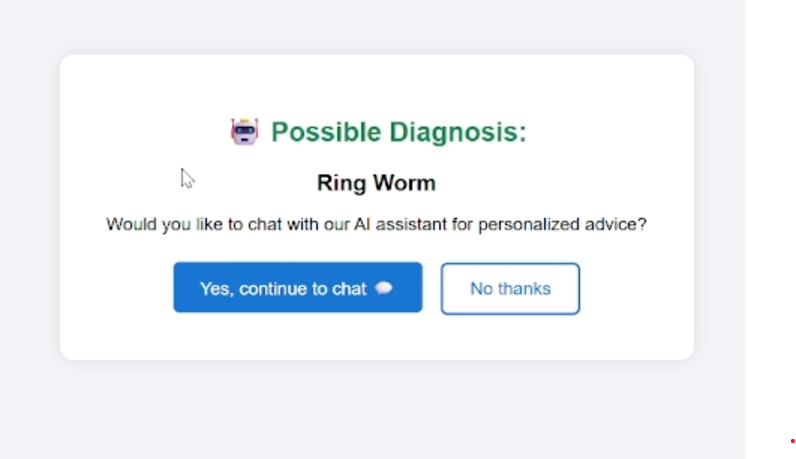
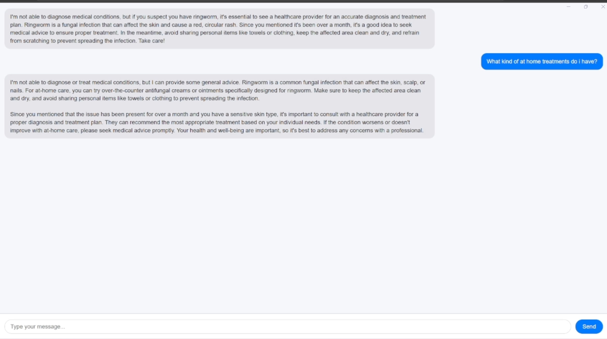

# 🧪 FungalVision – AI-Powered Fungal Infection Detection & Guidance

FungalVision is a full-stack AI health assistant that screens for possible fungal skin infections using a **custom-trained deep learning model** and provides **safe, contextual follow-up advice through an interactive GPT-4o chat interface**.

Users complete a brief intake survey, upload an image, and receive a **possible diagnosis (e.g., Ringworm)** along with optional AI-powered guidance for next steps.

Built in under 6 hours for a hackathon, FungalVision demonstrates how machine learning + LLMs can support early triage and improve access to dermatology — without replacing clinicians.

---

## 🚀 Features

- 🧠 Custom-trained convolutional neural network (Python + PyTorch)
- 🖼️ Image upload with inference and visual preview
- 📋 Symptom-based intake UI (skin type, duration, location, etc.)
- 🔍 AI classification with possible diagnosis
- 💬 **GPT-4o-powered chat** for treatment guidance and education
- ⚛️ Frontend built using React
- 🔐 Images processed locally / not stored remotely
- ⚡ Designed to be lightweight and deployable during a hackathon

---

## 🟢 Example User Flow

1. Select skin type
2. Choose affected area (e.g., torso, scalp)
3. Enter how long symptoms have been present
4. Upload image
5. Receive classification: **Possible Diagnosis – Cellulitis, Impetigo, FU-athlete-foot, Nail-Fungus, Ring Worm, Cutaneous Larva Migrans, Chickenpox, Shingles**
6. Ask follow-up questions through GPT-4o chat

---

## 📸 Screenshots

### 🧾 Step 1 – Intake Questionnaire

| Skin Type Selection        | Body Region                | Duration                   |
| -------------------------- | -------------------------- | -------------------------- |
|  |  |  |

---

### 🧬 Step 2 – Classification Results

| Image Upload               | AI Diagnosis               |
| -------------------------- | -------------------------- |
|  |  |

---

### 💬 Step 3 – GPT-4o Interactive Chat

| Example Chat Response      |
| -------------------------- |
|  |

> The chat assistant provides **non-medical general guidance** like OTC antifungal options, hygiene precautions, and when to see a clinician. It does **not** diagnose or treat.

---

## 🛠️ Tech Stack

### Frontend

- React
- CSS
- Modular UI components
- Animated guided intake flow

### Backend

- Python
- Flask
- PyTorch
- YOLOv5
- GPT-4o integration for safe treatment guidance

---

## 🧠 Model Details

- Task: Fungal skin infection detection
- Dataset: Dermatology images + manually curated augmentations
- Epochs: ~100
- Architecture: Custom CNN (or fine-tuned pretrained backbone)
- Inference time: <1s per image local
- Exported for lightweight deployment

> Optimized for hackathon conditions while still achieving solid classification performance.
